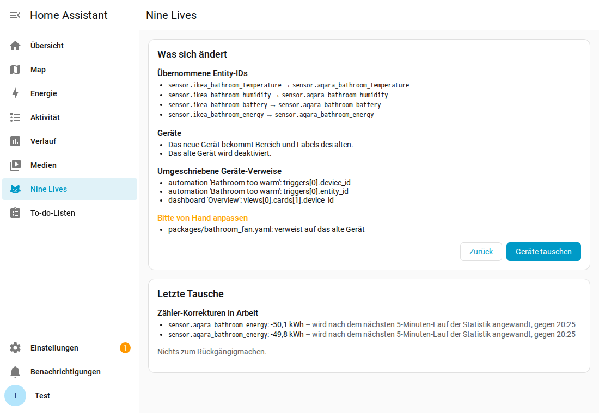
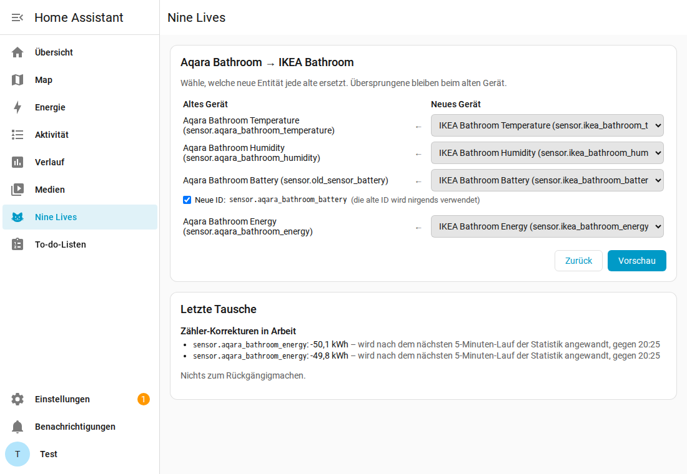
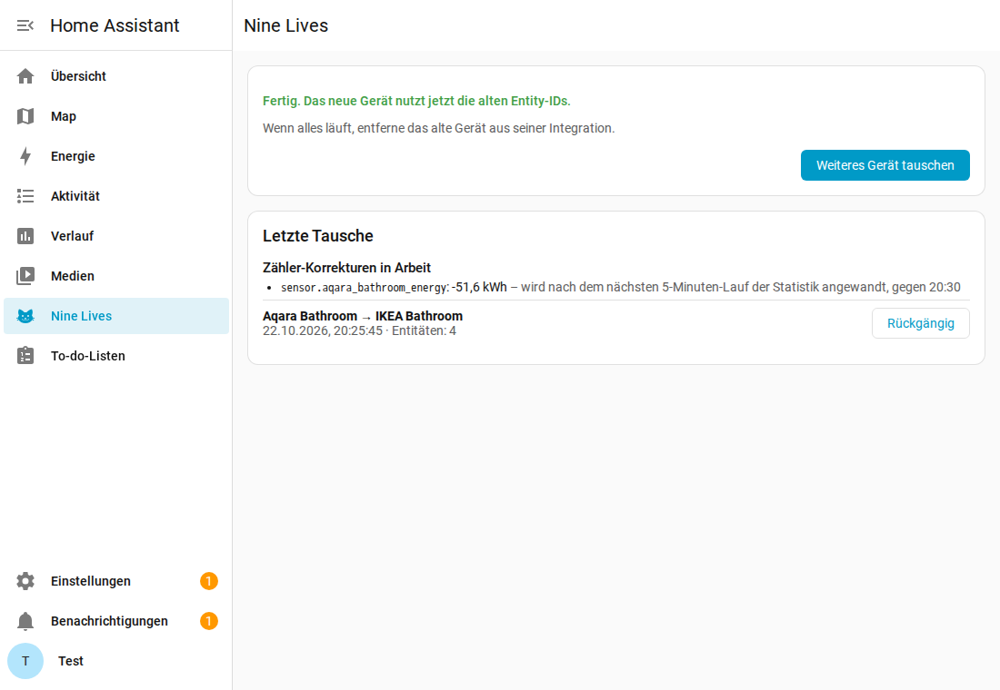

<p align="center"></p>

# Nine Lives

[English](README.md) · **Deutsch**

<p align="center">
  
  
  <a href="LICENSE"></a>
  
</p>

Einem Gerät ein neues Leben geben: es in Home Assistant ersetzen, ohne Automationen,
Dashboards und Verlauf zu zerstören – zum Beispiel beim Umzug von Sensoren von Zigbee auf
Thread/Matter oder wenn ein defektes Gerät gegen ein neues getauscht wird.

**Neu hier?** Die [Anleitung](docs/anleitung.md) erklärt einen Tausch Schritt für Schritt
und was genau dabei passiert.

<p align="center"></p>

## Warum

Wird ein Gerät ersetzt, sieht Home Assistant ein ganz neues Gerät mit neuen Entity-IDs.
Automationen, Dashboards und das Energie-Dashboard zeigen weiter auf die alten, und der
Verlauf beginnt von vorn. Das von Hand zu reparieren heißt: Entitäten in der richtigen
Reihenfolge umbenennen, Geräte-IDs in Automationen suchen und hoffen, dass die Statistik
überlebt. Nine Lives erledigt das in einem Schritt, zeigt vorher alles an und kann es
rückgängig machen.

## Funktionen

- **Gleiche Entity-IDs:** Die neuen Entitäten übernehmen die IDs der alten, dazu Namen,
  Icons, Bereiche, Labels, Aliase für Sprachassistenten und Optionen. Automationen, Skripte,
  Dashboards und Templates, die Entity-IDs verwenden, laufen ohne jede Änderung weiter.
- **Durchgehender Verlauf:** Die neuen Entitäten setzen Verlauf und Langzeitstatistik der
  alten fort, statt leer anzufangen.
- **Zähler ohne Sprung:** Summen für Energie, Gas und Wasser laufen glatt weiter. Der Sprung
  vom Zählerstand des alten zum neuen Zähler zählt nicht als Verbrauch, auch wenn das alte
  Gerät schon abgesteckt ist.
- **Geräte-Verweise umgeschrieben:** Geräte-Trigger, -Bedingungen und -Aktionen sowie
  Geräte-Ziele in Automationen, Skripten, Szenen und Dashboards zeigen auf das neue Gerät.
- **Kluge Zuordnung:** Entitäten werden nach Typ, Geräteklasse und Einheit gepaart, nicht nach
  Reihenfolge; jedes Paar lässt sich anpassen.
- **Vorschau und Rückgängig:** Jede Änderung wird vorher aufgelistet, und die letzten Tausche
  lassen sich mit einem Klick rückgängig machen.
- **Aufgeräumte IDs auf Wunsch:** Eine alte ID, die nicht mehr zum Namen passt, kann eine
  passende bekommen – aber nur, wenn nichts auf sie verweist.
- **Sicher gebaut:** YAML-Dateien wie Pakete werden nie bearbeitet, nur aufgelistet.
  Geräte-Trigger, die es am neuen Gerät vielleicht nicht gibt, werden zur Prüfung markiert.

## So funktioniert's

1. **Nine Lives** in der Seitenleiste öffnen und altes und neues Gerät wählen. Beide müssen
   in Home Assistant sein, das neue Gerät also vorher koppeln.
2. Die vorgeschlagene Zuordnung prüfen. Entitäten ohne Partner bleiben, wo sie sind.

   

3. Die Vorschau zeigt jede übernommene Entity-ID und jede Stelle, die sich ändert oder um die
   du dich kümmern solltest.
4. **Geräte tauschen.** Das alte Gerät wird deaktiviert, das neue bekommt seinen Bereich und
   seine Labels, und eine Benachrichtigung fasst zusammen, was noch zu tun ist.

   

5. Wenn alles läuft, das alte Gerät aus seiner Integration entfernen.

## Installation

Nine Lives braucht Home Assistant 2026.10 oder neuer.

**HACS:** In HACS das Menü → **Benutzerdefinierte Repositories** öffnen,
`https://github.com/Schnuecks/ha-nine-lives` mit dem Typ **Integration** hinzufügen, dann
**Nine Lives** installieren und Home Assistant neu starten.

**Von Hand:** `custom_components/nine_lives` in den Ordner `custom_components` deiner
Home-Assistant-Konfiguration kopieren und neu starten.

Danach die Integration unter **Einstellungen → Geräte & Dienste → Integration hinzufügen →
Nine Lives** einrichten. Das Panel erscheint für Admins in der Seitenleiste.

## Gut zu wissen

- **Zähler-Korrekturen dauern ein paar Minuten:** Home Assistant erstellt die Statistik alle
  fünf Minuten. Nine Lives korrigiert direkt danach; das Panel zeigt ausstehende Korrekturen.
- **YAML-Dateien gehören dir:** Pakete, `!include`-Dateien und YAML-Dashboards stehen unter
  „Bitte von Hand anpassen“. Das gilt auch für `automations.yaml`, wenn sie `!secret` oder
  `!include` nutzt, denn beim Umschreiben landeten diese Werte im Klartext in der Datei.
- **Geräte-Trigger:** Ein Trigger wie „Taste gedrückt“ einer Zigbee-Fernbedienung gibt es am
  neuen Gerät vielleicht nicht. Solche Trigger werden umgeschrieben, aber zur Prüfung markiert.
- **Rückgängig** geht, solange das alte Gerät noch existiert. Hast du es aus seiner
  Integration entfernt, bekommt das neue Gerät zwar seine eigenen IDs zurück, das alte kommt
  aber nicht wieder.
- **Was es nicht anfasst:** Nine Lives spricht weder mit den Geräten noch mit Diensten
  außerhalb von Home Assistant.

## Entwicklung

```bash
python -m venv .venv && . .venv/bin/activate
pip install -r requirements-dev.txt
ruff check . && ruff format --check . && pytest
```

Die Tests halten auch das Verhalten von Home Assistant fest, auf das sich der Tausch verlässt
(wie der Recorder umbenannte Entitäten und Zähler-Resets behandelt). Ändert Home Assistant
daran etwas, fällt es auf, bevor es jemanden seinen Verlauf kostet. Siehe
[CONTRIBUTING](CONTRIBUTING.md).

## Wie es entsteht

Nine Lives entsteht mit Unterstützung eines KI-Assistenten. Funktionen und Verhalten lege ich
fest, prüfe die Änderungen und teste sie in meinem eigenen Home Assistant, wo es meine
Steckdosen von Zigbee auf Thread umgezogen hat. Veröffentlicht wird nur, was die automatischen
Prüfungen besteht: die Tests, hassfest von Home Assistant und die HACS-Prüfung.

## Unterstützen

Nine Lives ist kostenlos und bleibt es. Wenn es dir Zeit spart, kannst du mir einen Kaffee
auf Ko-fi ausgeben; das hält das Projekt am Laufen. Danke!

<p>
  <a href="https://ko-fi.com/schnuecks"></a>
</p>

## Rückmeldungen

Fehler und Ideen sind als
[Issue auf GitHub](https://github.com/Schnuecks/ha-nine-lives/issues) willkommen. Siehe auch
[CONTRIBUTING](CONTRIBUTING.md) und [SECURITY](SECURITY.md).

Was sich in einer Version geändert hat, steht im [CHANGELOG](CHANGELOG.md) (auf Englisch).

**Was du erwarten kannst:** Nine Lives ist ein Hobby-Projekt, das ich in meinem eigenen
Home Assistant nutze. Issues und Pull Requests schaue ich mir an, wenn ich Zeit habe, ohne
feste Antwortzeit. Es macht bewusst nur eine Sache: ein Gerät sicher ersetzen. Ideen, die das
besser machen, sind sehr willkommen; Funktionen, die daraus etwas viel Größeres machen
würden, lehne ich eventuell ab, damit es klein und vertrauenswürdig bleibt.

## Lizenz

Copyright (c) 2026 Schnuecks. Veröffentlicht unter der [MIT-Lizenz](LICENSE).
