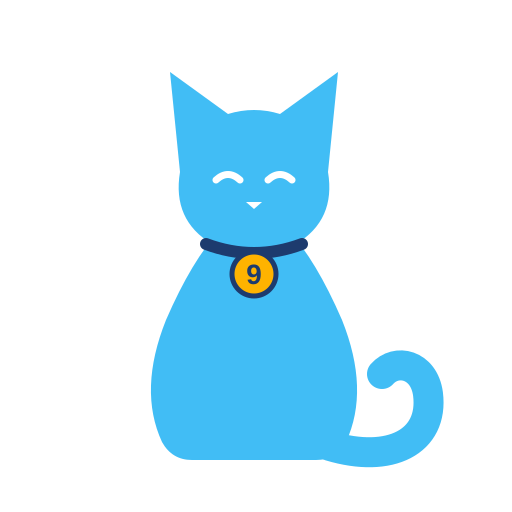

# Nine Lives

**English** · [Deutsch](README.de.md)

Give a device a new life: replace it in Home Assistant without breaking your automations,
dashboards and history – for example when moving sensors from Zigbee to Thread/Matter, or
when a broken device is swapped for a new one.

> **Status:** early development, not usable yet.

## What it will do

1. Pick the old and the new device in a sidebar panel.
2. Nine Lives pairs their entities (by domain, device class and unit); you can adjust the pairs.
3. A preview lists every place that changes: automations, scripts, scenes, dashboards,
   helpers, area, labels, names and voice assistant exposure.
4. Apply: the new entities take over the old entity IDs, and every reference is updated.
   A backup is written first, and one click undoes the swap.

Meters (energy, gas, water) keep a continuous sum: the step from the old meter's
reading to the new one's is not counted as consumption.

Places Nine Lives cannot change safely (YAML packages, `!include` files, device triggers
without a counterpart on the new device) are listed instead of being changed silently.

## Installation

Not released yet. Once it is: in [HACS](https://hacs.xyz/) add this repository as a
custom repository (type *Integration*), install Nine Lives, restart Home Assistant and add
the integration under **Settings → Devices & services**.

## Usage

Open **Nine Lives** in the sidebar (admins only), pick the old and the new device, check
the proposed entity pairs and the preview, then swap. Recent swaps are listed below and
can be undone. Once everything works, remove the old device from its integration.

## License

[MIT](LICENSE)
