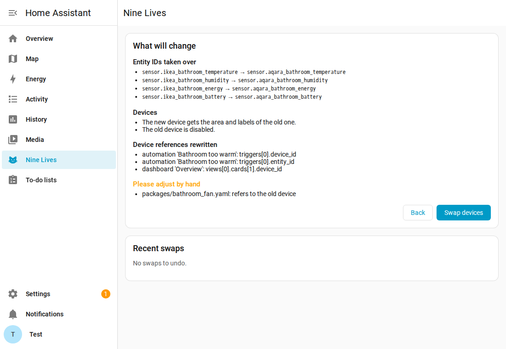
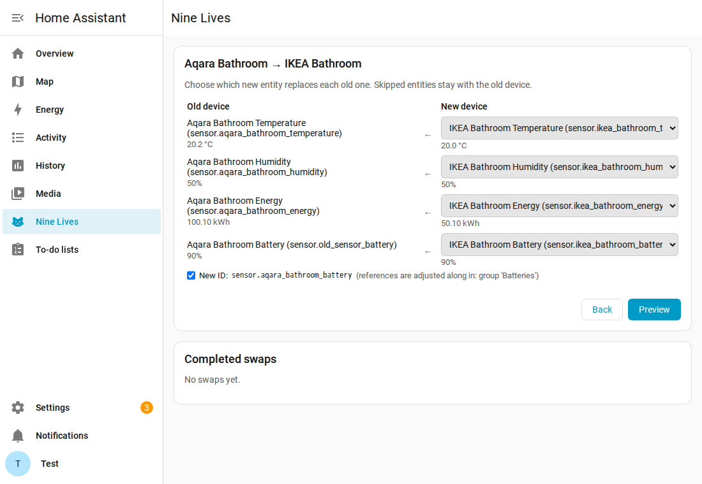
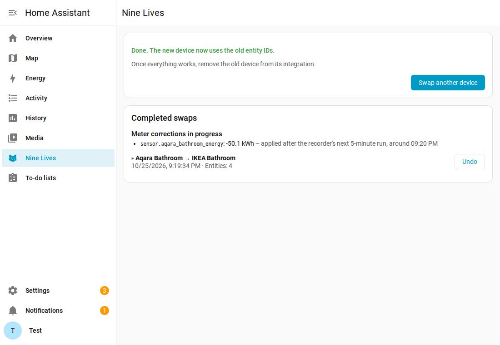

<p align="center"></p>

# Nine Lives

**English** · [Deutsch](README.de.md)

<p align="center">
  
  
  <a href="LICENSE"></a>
  
</p>

Give a device a new life: replace it in Home Assistant without breaking your automations,
dashboards and history – for example when moving sensors from Zigbee to Thread/Matter, or
when a broken device is swapped for a new one.

**New here?** The [guide](docs/guide.md) explains a swap step by step and what exactly
happens behind it.

<p align="center"><picture><source media="(prefers-color-scheme: dark)" srcset="docs/screenshots/preview-dark.png"></picture></p>

## Why

When a device is replaced, Home Assistant sees a brand-new device with new entity IDs.
Automations, dashboards and the energy dashboard still point to the old ones, and the history
starts from scratch. Fixing that by hand means renaming entities in the right order, hunting
for device IDs in automations and hoping the statistics survive. Nine Lives does it in one
step, shows everything first and can undo it.

## Features

- **Same entity IDs:** the new entities take over the IDs of the old ones, together with
  names, icons, areas, labels, voice assistant aliases and options. Automations, scripts,
  dashboards and templates that use entity IDs keep working without a single change.
- **Continuous history:** the new entities continue the old history and long-term
  statistics instead of starting empty.
- **Meters without jumps:** energy, gas and water sums continue smoothly. The step from the
  old meter's reading to the new one's is not counted as consumption, even when the old
  device is already unplugged.
- **Device references rewritten:** device triggers, conditions and actions and device targets
  in automations, scripts, scenes and dashboards point to the new device.
- **Smart pairing:** entities are paired by type, device class and unit, not by order; you
  can adjust every pair.
- **Preview and undo:** every change is listed before it happens, and recent swaps can be
  undone with one click.
- **Tidier IDs on request:** an old ID that no longer matches its name can get a fitting
  one. Automations, scripts, scenes, dashboards, helpers such as groups and the energy
  dashboard are adjusted along; IDs used in YAML files or other integrations' settings stay.
- **Safe by design:** YAML files such as packages are never edited, only listed. Device
  triggers that may not exist on the new device are flagged for review.

## How it works

1. Open **Nine Lives** in the sidebar and pick the old and the new device. Both must be in
   Home Assistant, so pair the new device first.
2. Check the proposed pairs. Entities without a partner stay where they are.

   <picture><source media="(prefers-color-scheme: dark)" srcset="docs/screenshots/pairs-dark.png"></picture>

3. The preview lists every entity ID that is taken over and every place that changes or
   needs your attention.
4. **Swap devices.** The old device is disabled, the new one gets its area and labels, and a
   notification sums up what is left to do.

   <picture><source media="(prefers-color-scheme: dark)" srcset="docs/screenshots/done-dark.png"></picture>

5. Once everything works, remove the old device from its integration.

## Installation

Nine Lives needs Home Assistant 2026.10 or newer.

**HACS:** in HACS open the menu → **Custom repositories**, add
`https://github.com/Schnuecks/ha-nine-lives` with the type **Integration**, then install
**Nine Lives** and restart Home Assistant.

**Manually:** copy `custom_components/nine_lives` into the `custom_components` folder of
your Home Assistant configuration and restart.

Then add the integration under **Settings → Devices & services → Add integration →
Nine Lives**. The panel appears in the sidebar for admins.

## Good to know

- **Meter corrections take a few minutes:** Home Assistant compiles statistics every five
  minutes. Nine Lives applies the correction right after that; the panel shows pending ones.
- **YAML files are yours:** packages, `!include` files and YAML dashboards are listed under
  "Please adjust by hand". The same goes for `automations.yaml` if it uses `!secret` or
  `!include`, because rewriting it would write those values into the file.
- **Device triggers:** a trigger like "button pressed" of a Zigbee remote may not exist on
  the new device. Such triggers are rewritten but flagged for review.
- **Old device already deleted?** Its entities can still be taken over from the entries Home
  Assistant keeps after a removal, see the [guide](docs/guide.md#old-device-already-removed).
- **Undo** works as long as the old device still exists. Once you removed it from its
  integration, the swap is final and no longer offers undo; it stays in the list of completed
  swaps.
- **What it does not touch:** Nine Lives does not talk to the devices or to any service
  outside Home Assistant.

## Development

```bash
python -m venv .venv && . .venv/bin/activate
pip install -r requirements-dev.txt
ruff check . && ruff format --check . && pytest
```

The tests also pin down the Home Assistant behaviour the swap relies on (how the recorder
treats renamed entities and meter resets), so a change in Home Assistant shows up before it
can cost anyone their history. See [CONTRIBUTING](CONTRIBUTING.md).

## How it's built

Nine Lives is developed with the help of an AI coding assistant. I define the features and
behaviour, review the changes and test them in my own Home Assistant, where it moved my
smart plugs from Zigbee to Thread. Nothing is released without passing the automated checks:
the test suite, Home Assistant's hassfest and the HACS validation.

## Support

Nine Lives is free and stays free. If it saves you time, you can buy me a coffee on Ko-fi;
it keeps the project going. Thank you!

<p>
  <a href="https://ko-fi.com/schnuecks"></a>
</p>

## Feedback

Bug reports and ideas are welcome as
[GitHub issues](https://github.com/Schnuecks/ha-nine-lives/issues). See also
[CONTRIBUTING](CONTRIBUTING.md) and [SECURITY](SECURITY.md).

What changed in each version is listed in the [CHANGELOG](CHANGELOG.md).

**What to expect:** Nine Lives is a hobby project that I use in my own Home Assistant. I look
at issues and pull requests as time allows, without a guaranteed response time. It
deliberately does one thing: replace a device safely. Ideas that make that better are very
welcome; features that would turn it into something bigger may be declined to keep it small
and easy to trust.

## License

Copyright (c) 2026 Schnuecks. Released under the [MIT License](LICENSE).
